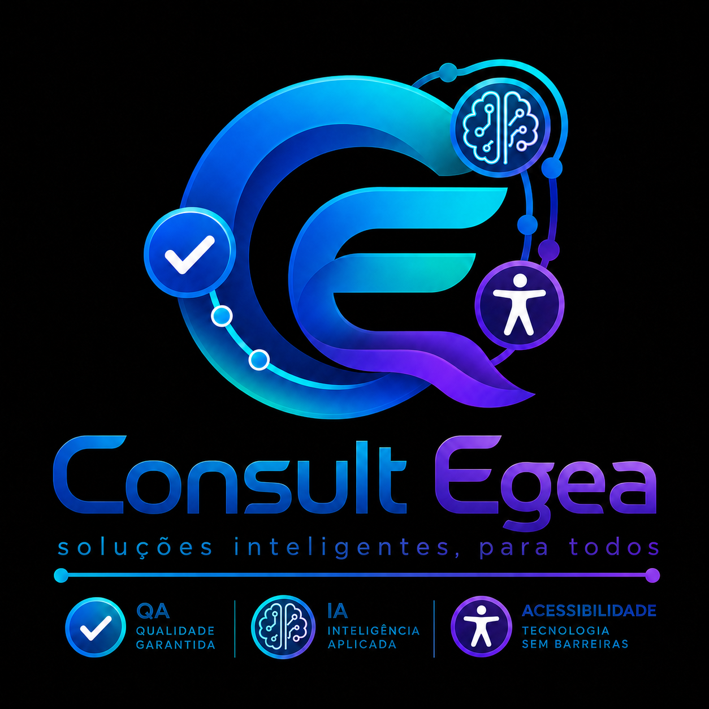

# Geovana Egea

### Quality Engineering • Coordenação de Acessibilidade Digital • Produto & IA

**Transformo necessidades de negócio em soluções digitais, processos de qualidade e experiências mais acessíveis.**

**São Paulo, Brasil · Produtos disponíveis comercialmente · Consultoria remota**

---

## Sobre mim

Sou profissional de **Quality Assurance**, com atuação em **coordenação de acessibilidade digital**, mentoria de QAs e desenvolvedores, análise de requisitos, visão de produto e gestão da qualidade em ambientes regulados.

Minha experiência conecta negócio e tecnologia: estruturo estratégias de testes, priorizo riscos, documento sistemas complexos, conduzo validações de acessibilidade e desenvolvo soluções digitais com apoio de IA. Trabalhei com organizações dos setores **bancário, jurídico, regulatório e de tecnologia**, preservando a confidencialidade de seus nomes e informações internas.

Na **Consult Egea**, reúno essa experiência em produtos e serviços para equipes que buscam qualidade, acessibilidade e processos mais eficientes.

> Mais do que encontrar defeitos: entender o negócio, orientar equipes e transformar problemas em entregas verificáveis.

## Onde gero valor

| Especialidade | Atuação |
|---|---|
| **Liderança e acessibilidade** | Coordenação de frentes de acessibilidade, mentoria de QAs e desenvolvedores, testes com teclado e tecnologias assistivas, WCAG 2.1/2.2 A/AA. |
| **Qualidade de software** | Testes funcionais web/mobile, exploratórios, regressão, cenários, casos, evidências e gestão de defeitos. |
| **Produto e requisitos** | Atuação integrada de PO e QA, critérios de aceite, backlog, engenharia reversa, especificações e comunicação com stakeholders. |
| **IA e soluções digitais** | Desenvolvimento assistido por IA, prototipação navegável, painéis e ferramentas de apoio às equipes. |
| **Governança** | Rastreabilidade, relatórios executivos, avaliação de riscos e suporte à tomada de decisão. |

## Portfólio e projetos

**[Ver portfólio profissional completo](https://geegea.github.io/GeEgea/)**

### Cases por setor

- **Tecnologia regulatória e serviços financeiros:** estratégia de testes, documentação de produto, acompanhamento de funcionalidades e observabilidade.
- **Setor bancário:** acessibilidade digital e aplicação de critérios WCAG com orientação de equipes técnicas.
- **Tecnologia jurídica:** especificação, prototipação de CRM, fluxos e qualidade de produto.
- **Inteligência artificial:** cenários de avaliação, regressão e análise de comportamento de agentes.
- **Sistemas corporativos:** engenharia reversa, organização de requisitos e rastreabilidade.

*Os cases são apresentados sem identificar empresas atendidas nem expor informações confidenciais.*

## Produtos Consult Egea — disponíveis para contratação

**Produtos e soluções disponíveis comercialmente.** Para conhecer demonstrações, licenciamento, implantação, personalizações ou contratação, acesse o site oficial.

| Produto | Solução | Contato comercial |
|---|---|---|
| **CE QI+** | Gestão de avaliações, achados, evidências, indicadores e relatórios de qualidade. | [Solicitar proposta](https://consultegea.com.br/) |
| **CE IA+** | Apoio à avaliação de acessibilidade digital e elaboração de relatórios WCAG. | [Solicitar proposta](https://consultegea.com.br/) |
| **QA Nav** | Extensão para testes manuais assistidos e análise de componentes de interfaces. | [Solicitar proposta](https://consultegea.com.br/) |
| **WCAG Scanner** | Diagnóstico automatizado de acessibilidade com checklist de revisão manual. | [Solicitar proposta](https://consultegea.com.br/) |
| **CE QI / Command Center** | Painéis de observabilidade e indicadores de qualidade. | [Solicitar proposta](https://consultegea.com.br/) |
| **QA Mãe Skills e AQE Skills** | Skills especializadas de QA e acessibilidade para fluxos assistidos por IA. | [Solicitar proposta](https://consultegea.com.br/) |
| **QA Support Toolkit** | Toolkit público e serviços de adaptação para equipes. | [Ver repositório](https://github.com/GeEgea/qa-support-toolkit) |
| **Jira Backup Automation** | Apoio à exportação e organização de dados do Jira, conforme permissões. | [Solicitar proposta](https://consultegea.com.br/) |

**Preços e condições:** definidos em proposta comercial. O GitHub é uma vitrine; a contratação ocorre por meio da **[Consult Egea](https://consultegea.com.br/)**.

## Ferramentas e competências

**Acessibilidade e qualidade:** WCAG 2.1/2.2 · axe-core · Lighthouse · WAVE · NVDA · JAWS · VoiceOver · Jira · Zephyr · Postman · Playwright · Cypress (em evolução).

**Produto, tecnologia e IA:** React · Next.js · TypeScript · Vue/Vuetify · Vite · Prisma/PostgreSQL · Git/GitHub · Claude · Codex.

**Métodos:** análise de requisitos · design de fluxos · prototipação · documentação · mentoria · comunicação negócio–tecnologia.

*Parte do desenvolvimento e automação é realizada com apoio de IA; isso não representa o mesmo nível de proficiência em todas as ferramentas.*

## Parcerias e contratação

### [Conheça os produtos e contrate pela Consult Egea](https://consultegea.com.br/)

[Site oficial](https://consultegea.com.br/) · [Portfólio](https://geegea.github.io/GeEgea/) · [LinkedIn](https://www.linkedin.com/in/geovana-egea/) · [E-mail](mailto:egea.ge@gmail.com)

Geovana Egea · Consult Egea — Soluções Inteligentes

